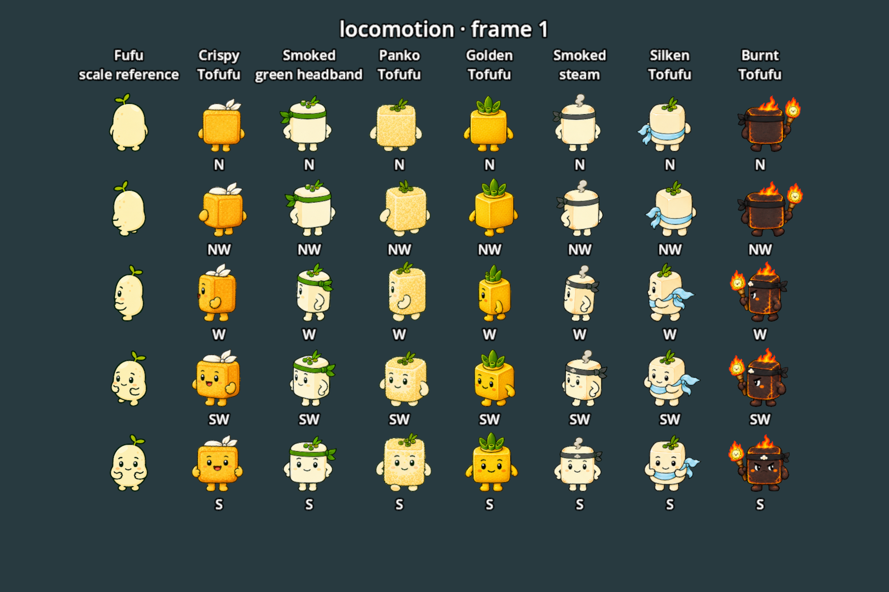

# Tofufu character animation library

Seven character folders correspond to the attached images in their original order.
The green-headband character in image 2 is **Firm Tofufu**; image 5 is Smoked
Tofufu with steam. The historical `smoked_tofufu_green_headband` folder remains
the stable asset ID for Firm Tofufu.

| Image | Character folder | Defining appearance |
| --- | --- | --- |
| 1 | [crispy_tofufu](crispy_tofufu/) | Golden crust, white top bandana |
| 2 | [Firm Tofufu](smoked_tofufu_green_headband/) | Ivory tofu, green headband and scallion garnish |
| 3 | [panko_tofufu](panko_tofufu/) | Pale flower-shaped crumbs and scallion garnish |
| 4 | [golden_tofufu](golden_tofufu/) | Golden cube, three green bamboo shoots |
| 5 | [smoked_tofufu_steam](smoked_tofufu_steam/) | Ivory tofu, grey headband and steam curl |
| 6 | [silken_tofufu](silken_tofufu/) | Ivory tofu, blue waist sash and scallions |
| 7 | [burnt_tofufu](burnt_tofufu/) | Burnt Tofufu: charred lava tofu, dark headband and flaming staff |



`preview.png` is a native Godot render produced by the included preview script.

Every folder contains:

- `source/walk-original.png`: the unchanged supplied walking sheet.
- `locomotion.png`: five rows × five columns; columns standing, walk contact,
  passing, opposite contact, opposite passing.
- `jump.png`: five rows × ten columns matching Fufu's takeoff, push-off, ascent,
  apex, fall start, mid-fall, pre-landing, landing impact, rebound, settled phases.
- `melee.png`: five rows × four columns; jab, cross, uppercut, kick contact poses.
- `animations.tres`: 35 named Godot SpriteFrames animations, already sliced.
- `sprite-layout.json`: exact atlas regions, torso centers, foot baselines and pixel sizes.
- `SOURCE.md`: identity, generation provenance and usage notes.

All new sheets use the same row order: **N, NW, W, SW, S**. Mirror NW/W/SW
with `flip_h` for NE/E/SE. This is visual mirroring, including asymmetric
accessories, following the requested five-angle convention. The supplied walking
originals retain their original S/N/W row order. New sheets are real RGBA images.

There are **95 authored poses per character, 665 total**. PNGs retain their native
generated resolution without resampling. Regions follow connected painted bounds,
not an assumed grid; this avoids neighboring sprite fragments. `animations.tres`
uses transparent AtlasTexture margins to register all frames on a 512×512 canvas
with the foot pivot at (256,448), without changing source pixels. Use a single
uniform scale per sheet from `sprite-layout.json` when switching animation
categories; neutral full-character height is calibrated to 1.12 world units.
The solid torso determines horizontal registration; stepping toes, fists and
asymmetric accessories cannot shift the body sideways. Feet determine only the
vertical baseline, preserving grounded poses and landing squash. For
Sprite3D, use unshaded billboarding with alpha discard at 0.5, as in the preview.
Keep atlas mipmaps disabled to avoid sampling neighboring sprites.
Jump height comes from the actor motor, rather than being painted into cell offsets.

The 3D Fufu display in the meadow courtyard near Grandma now opens a test skin
selector with the normal interact binding (E by default). Choose any of these seven
skins or return to Fufu. The choice affects the local player for this session only,
including standing, walking, jumping and melee contacts. It overrides outfit art
while selected, retaining actual equipment and restoring its appearance when you
choose Fufu. No save fields, network messages or combat rules are changed. The four melee sprites
are contact poses, matching Fufu's current body-art convention; runtime timing and
follow-through belong to presentation code when these characters are wired in.

## Browse and preview

Open a character's `animations.tres` in Godot's SpriteFrames editor. Named animations
include `idle_n`, `walk_nw`, `jump_sw`, `jab_w`, `cross_s`, `uppercut_n`, `kick_sw`.

From the project root, render every authored pose and a mirrored view beside Fufu:

```sh
/Applications/Godot.app/Contents/MacOS/Godot --path . --script res://tests/preview_tofufu_library.gd
```

The preview saves 20 boards under `user://tofufu-library-preview/` and exits.
Run it with `--headless` to check resource loading and frame coverage without images.
`build_library.py` reads alpha and rewrites only JSON/TRES metadata; it never edits
PNG pixels. It requires Pillow and NumPy and reuses the existing Fufu unarmed
atlas connected-component reader. Exact built-in ImageGen prompts and source
paths are retained in `generation-prompts.json`; targeted correction requests live
beside retained earlier versions under each applicable `source/` folder.

`preview_tofufu_alignment.gd` renders every skin in all eight directions on fixed
torso axes. `test_tofufu_alignment.gd` checks source alpha anchors and travel/aim
directions through camera rotation. Runtime Battle Royale walking faces travel;
shots and melee continue to face aim.
