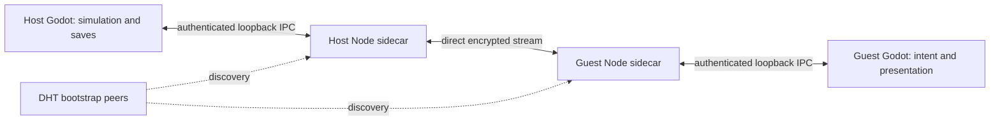

# Co-op architecture

### Jungle Bengals and Bengal Paws (implemented; live version 61)

Twelve level-15 Bengals append after the 59 existing encounter slots. They use
240 HP, 30-damage committed claws, 5.6 m/s pursuit and 18-second respawns in both
weather states. Five painted views cover eight observer-relative facings by
mirroring; separate idle, two running strides and claw poses are cosmetic.
Bengal records contain twelve values: the existing nine mob values, two facing
components and a bounded 0..0.25-second claw pose. The 59-slot and older supported
checkpoints remain valid. `WorldMobProtocol` owns fixed-roster validation.

Each authoritative Bengal defeat makes exactly one unmodified 1% roll for Bengal
Paws, alongside the separate existing Magical Tofufu roll. The level-15 weapon
uses the normal inventory, personal deposits, enhancement, world-drop and
save/checkpoint contracts; Grandpa Fufu also stocks it for free playtesting. Confirmed claws
train fist and attack-speed practice once each per attack, including a successful
Super Claw. Misses and replicas grant no training. Existing practice counters
require no migration.

Paws deal 16 base fist-scaled damage at a 0.33-second base cadence. Holding
RMB for two seconds automatically commits a 20-SP dash, starting an eight-second
cooldown that survives swaps and saves. Early release cancels without cost.
Aim can change while charging and locks at launch. The dash travels at 20 m/s
for at most 0.36 seconds, shortening its route to approach the aimed target.
Collision-resolved segments hit each target once for normal damage. The separate
frontal rift finisher deals three times normal damage and paralyzes surviving
enemies for four seconds. Both stages check terrain occlusion; solid walls end
the dash. The complete skill grants each practice type at most once.

Selected paws multiply walking/running by 1.15 and ordinary dash cooldown/SP
costs by 0.75. These are per-actor modifiers, composed with progression and
outfits without changing shared tuning; stowing paws removes them. App-owned
`ActorCombatMotion` injects ability velocity, command restrictions and actor-pass
presentation into Player. Physics still uses move_and_slide against terrain.
Guest movement follows received dash velocity without resolving combat.

Actor snapshots add optional bounded paw selection, charge, charging/dashing
flags, remaining dash time, cooldown, launch/finisher sequences, origin and aim.
Restoring authority cancels transient attacks and retains cooldown, preventing
saved attacks from replaying. Solo saves optionally retain the same bounded
cooldown; legacy records default to zero. Replicas display charging claws,
dash trails and the received finisher sequence without executing attacks.
The world's optional `mob_paralysis` array carries one 0..4-second timer per
captured mob; factory live rows accept an optional sixth timer, and castle
guardian/king records an optional bounded timer. Older records default to zero.
Player combat and static harvest/practice targets do not receive enemy paralysis.
Version 61 peers are required for charged-dash presentation and the new mechanics.
Actor-health validation permits only 0.000001 HP of decimal-rounding tolerance
above the computed level maximum, and authority restoration clamps to that exact
maximum. This preserves full-health level-15 characters across JSON transport.

The special's local VFX lasts 1.05 seconds: an expanding triple rake opens a
painted cosmic slit, with animated rim/chromatic shimmer and twelve batched glass
shards, then collapses. The effect uses depth testing and no full-screen overlay
or gameplay light. Three small fractured bonds follow a paralyzed enemy until
its received status expires. These components do not resolve hits, alter status
timers or spend resources; they share the existing cast sequence on all peers.

## Implemented scope

The existing adventure supports a solo host with up to three joining friends: the shared pod escape, movement, knife/fist/soybean-gun combat, directional guarding, dropped-knife recovery, damage/respawn, mobs, dummies, harvesting, Edamame ground pickups, discoveries, EXP and day/night. Guests can join during play and rejoin their saved character. The host saves the party and world. Offline play remains independent of the networking runtime.

Opening co-op automatically starts friend discovery with the device’s saved nickname; offline startup stays disconnected. Nicknames can be changed explicitly in the idle lobby, which restarts discovery while retaining the transport identity. Connection errors require an explicit retry. **Host world** selects a new or saved adventure and starts it in one action; guests use **Join world**. Compatible testers share `tofufu-adventure/public-playtest/v2`; up to 32 reachable peers appear in the lobby. Hosts accept three guests, without accounts or invitations. A public topic is not a tester allowlist. Restrictive networks can prevent a direct connection.

## N1 — Direct connectivity and a local runtime (implemented)

Pinned Hyperswarm 4.17.1 runs in Node.js 22+. The parent passes an OS-assigned loopback port, fresh random capability and local identity-file path over inherited stdin. The Godot adapter owns startup deadlines, polling and child retirement. No capability is placed in command-line arguments. Offline startup spawns no child; leaving discovery closes it. Desktop exports use the staging helper described in `networking/README.md`.

The sidecar persists a random 32-byte identity seed in the game's user directory, with owner-only permissions on POSIX. Encrypted connection keys identify members; names are display labels. Reusing the profile retains the character identity across restarts. Corrupt identities produce an error instead of silently replacing the key. Copies of one profile must not run simultaneously.

This project's direct-only policy uses `relayThrough: () => null` in the pinned implementation. DHT/bootstrap peers provide discovery, but no automatic gameplay payload relay is selected. Initial discovery refresh and subsequent 20-second refreshes handle simultaneous starters. Handshakes and heartbeats expire silent connections. Transport behavior is based on the pinned source and [Hyperswarm's API](https://github.com/holepunchto/hyperswarm); keyed connectivity and hole punching are provided by [HyperDHT](https://github.com/holepunchto/hyperdht). Neither library guarantees connectivity through every NAT.

## N1a — Replaceable transport backend (implemented)

`networking/godot/SessionTransport` is the abstract Node contract for discovery, authenticated reliable ordered packets, and resource lifecycle. `HolepunchTransport` implements it. `game/app/bootstrap/launch.tscn` selects the concrete transport child through the launch script's exported `transport` reference. `SessionConnection` wires it to `PlaytestRoom` and owns discovery/disconnect/shutdown composition. The launcher, room, gameplay and lobby scripts do not construct or reference Holepunch. Backend descriptions are supplied as display data to the lobby.

The contract has `start(display_name)`, `send_packet(key, data)`, idempotent `close()`, `is_closed()` and awaitable `shutdown()`. Constructing/adding a transport must not connect or spawn anything; the app starts friend discovery on co-op entry. Dedicated mode still requires an explicit connection action. `start` replaces an old connection, and `close` immediately stops its delivery/events while retiring resources. Implementations must bound startup, connection and retirement time, finish cleanup even while menus are open, and clean up on tree exit. `shutdown` waits for `is_closed`, so an implementation must enforce its own retirement deadline. Reopening must not deliver events from a previous connection. `SessionConnection` clears room discovery state on disconnect; leaving a world alone keeps discovery available.

The `event_received(Dictionary)` schema intentionally retains the existing bounded JSON value protocol:

| Event type | Required values | Meaning |
| --- | --- | --- |
| `ready` | `key`, `name` strings | Local authenticated identity is available |
| `searching` | none | Discovery is active |
| `peer` | `key`, `name` strings | Authenticated remote endpoint can receive packets |
| `left` | `key` string | Remote endpoint disconnected |
| `packet` | `key` string, `data` dictionary | Message bound to its authenticated sender |
| `error` | `message` string | Terminal backend failure; adapter closes resources before emitting |

Adapters must validate external data, emit `ready` before peers, announce a peer before its packets, and never accept a sender identity supplied by an untrusted payload. Delivery is reliable and ordered per endpoint; payloads remain bounded to the existing 64-KiB envelope and queues/rates remain bounded. Identity is a stable lowercase 64-character hexadecimal application ID, as required by current room, chat and checkpoint schemas. Holepunch uses its encrypted public key. Another backend must authenticate and consistently map its account IDs to this representation; display names are never identity. Existing character saves require an explicit trusted identity migration if the mapping changes.

To replace Holepunch, implement this contract under `networking/` and change the transport child script/configuration in `launch.tscn`. Endpoint URLs, credentials, SDKs and service-specific discovery belong in that adapter, not in room rules or views. A centralized directory/message service can expose the same authenticated endpoint semantics and reuse the current presence/join/roster/gameplay protocol. The optional Oracle dedicated adapter and deployment are described in N8. Holepunch remains the default; production account authentication and identity migration are still planned. There is no automatic fallback.

Transport replacement alone does not relocate authority: the default participating player still simulates and saves the world, and host loss ends play. The explicit dedicated composition in N8 separately changes room membership, authority and persistence. Holepunch's current direct-only policy continues to apply to its adapter; selecting a future centralized backend must be deliberate.

`tests/test_session_transport.gd` supplies an alternate local implementation and exercises discovery, admission, gameplay delivery, reconnect, host loss, errors, delayed cleanup and actual launch-scene injection without Node or the network. The architecture checker prevents concrete Holepunch dependencies returning to game scripts.

## N2 — Session, authority and composition (implemented)

Room message validation/dispatch lives in `game/session/room_messages.gd`; room state and lifecycle stay on `PlaytestRoom`. App replication lives in `game/app/coop/`; `CoopActorReplica` presents received state through its explicit actor owner. This organization preserves packet/save schemas and callback order.

`PlaytestRoom` owns presence, build/protocol compatibility, capacity, host-issued roster, room epoch, join/start/leave and host-loss behavior. Only the host's roster admits actors. A host can start exploring with no guests and remains discoverable. Unexpected host disconnection or an interrupted join retains the selected host for a bounded 20-second retry window; rediscovery permits a new join request every two seconds. Explicit leave/rejection cancels retry, and expiration reports an actionable message. Rejoining reconstructs the guest scene from host state; it does not migrate authority. A guest sends ready after composing its scene; a valid complete world snapshot enables its input. Join-in-progress uses the same path. Leaving guests are removed from active simulation, while their character checkpoint remains available for rejoining. A world retains at most 32 character identities.

`app/coop/CoopSession` composes `CoopRoster`, `CoopActor`, `CoopOpening`, `CoopWorld` and `CoopEncounters`. These app objects connect independent features; movement rules never read networking. The host executes every actor's commands through the existing movement, equipment and collision rules. Mobs choose the nearest eligible party member; Edamame pickups select a nearby collector, add one bean to that character's backpack only when there is space, and award shared progress exactly once. Soybean guns have friendly fire: app composition injects every other live party health receiver into each gun, excluding its owner. The host sweeps projectile segments against world and actor colliders, applies base 20 body or 40 upper-region damage scaled by character/shooting progression, and existing health/respawn snapshots replicate the outcome. Knife and fist target lists also include every other party member, with separate per-actor arrays excluding self. Friendly hits respect directional guarding, dash immunity and damage reduction; teammates do not award weapon practice. Typed hit counters distinguish slime, soybean and melee feedback, including fatal hits followed by immediate respawn. Only slime triggers the local screen smear; soybeans trigger a short amber ring of flecks. Living players and snails block one another through their physics capsules on the host, including dashes. Shared collision-aware player placement prevents occupied joins, respawns and checkpoint restores; hidden pod participants disable their actor layer until revealed. Guests continue displaying authoritative state rather than deciding collision outcomes.

Guests disable authoritative actor, encounter and quest outcome simulation. The locally owned actor predicts movement with the existing motor and capsule collisions. Host snapshots acknowledge consumed input sequences; a bounded history of predicted positions corrects position error smoothly on physics ticks. Respawns and large teleports reset history and movement timers; prediction stops after 250 ms without a snapshot or 120 outstanding ticks. This is positional reconciliation, not deterministic input replay: collision and jump/dash timer differences can still require corrections. Other actors use `ReplicaMotion`: up to eight received positions, a 25 ms interpolation delay, and at most 100 ms of velocity extrapolation. Respawns, transport changes and large teleports discard old samples. Camera and existing character sprites interpolate between physics positions on render frames; the camera precedes character hands and weapon views. There is one Fufu sprite per actor, and presentation never moves the authoritative capsule. Guests apply world state, and present sword swings, guarding, punches, dropped knives, health and respawns. Each guest retains its own camera and HUD. All players may contribute to the shared opening; the host alone advances the pod rules and broadcasts the cinematic state. During online menus the world continues and local input is neutralized. Host departure ends the session; it does not elect another authority.

## N3 — Bounded protocol (implemented)

Live version 43 adds the reverse melee move (style 6), a bounded chain cursor (0–3), weapon contact pause (0–0.075 seconds), and player impact motion (`remaining` 0–0.24 seconds, planar `push` length at most 9). All live peers require version 43. The host owns buffered attack selection, resource payment, swept contact, interruption, immunity and launch velocity. Guests display the host move/elapsed clock and pause; local movement prediction adopts host recoil/vertical velocity so input cannot immediately overwrite a received hit. Encounter positions and velocities already carry enemy launches, so world encounter row shapes are unchanged. Replica flashes and weapon paths do not resolve damage. Legacy checkpoints default missing impact fields to zero; transient recoil and pending attacks clear on checkpoint placement.

Live version 38 requires the refined meadow collision geometry, depot side entrance and relocated farm buildings. Version 37 required the expanded volcanic world and castle collision geometry; actor and world snapshot fields are unchanged. Version 32 added held `run_held` intent and bounded actor `endurance` records (0–100 current, 0–1.2 rest delay, boolean exhaustion). The authority spends and recovers running reserve through the same motor as offline play; the owner predicts movement and accepts host reserve corrections. Guests never decide charged melee damage or SP payment. Old actor/solo records without endurance still load with a full reserve; older peers require an updated build for the new controls and movement balance. Duel rounds reset endurance and cleanup restores the pre-duel reserve. Winter precipitation is a local 3D view of the synchronized weather clock and biome, with no new weather packets.

Version 29 added bounded `apple_harvest` intents carrying a member sequence and one of twenty tree indices. E shakes an in-reach orchard tree; the authority checks membership, health, duel/opening exclusion, proximity and fruit readiness before creating one shared four-apple stack. Ground fruit stays visible until an explicit E pickup grants it through the existing world-item path. Replayed or simultaneous shakes cannot duplicate fruit. Apple-tree and ground-item checkpoint shapes remain unchanged.

Armored-snail encounter rows append shell HP (0–65) and two horizontal facing components to the existing nine values. Legacy nine-value checkpoints restore an intact shell. The host owns armor damage and loot; replicas apply shell state and play hit/break feedback on decreases. Matchmaking game version 22 requires peers with this schema. Edamame ground drops use one bounded stack row per drop, with legacy single-bean rows still accepted.

Both streams use a four-byte big-endian JSON length, maximum 64 KiB per frame. Encrypted peer frames of at least 256 bytes use level-six raw DEFLATE inside a JSON/base64 envelope when it reduces bytes; decoded JSON still has the same 64 KiB bound. Invalid compression, oversized expansion and malformed JSON close the offending connection. Loopback IPC retains ordinary JSON. Peer admission remains capped at 180 frames/second; aggregate authenticated loopback IPC permits 600, so three guests sending 60 Hz inputs plus chat do not exceed the old 180-frame limit. Incremental decoding handles fragmentation/coalescing, rejects malformed frames and caps buffers at 256 KiB. Peer framing limits message rates and uses explicit queued-byte accounting plus a three-second stalled-write deadline. Loopback Node streams complete writes through callbacks; encrypted streamx peers use `Writable.drained()` because their `write()` does not accept a callback. Completed writes release queued bytes and cancel the stall deadline on both paths. Handshake version/build and session epoch reject incompatible or obsolete traffic. Sender identity comes from the encrypted stream, never from an input field.

`ExplorationProtocol` validates finite bounded vectors, booleans, integer counters and actor/combat records. `WorldProtocol` validates the fixed-content world and opening records. No remote object or Resource deserialization is used. `InputWindow` rejects duplicate/replayed inputs, future acknowledgements, acknowledgements over 180 host ticks old, sequence leaps over 240 and input rates over 90 per second. Remote queues hold at most 12 commands. Each host tick consumes the newest held intent and coalesces queued one-shot actions once, so different peer tick rates do not accumulate simulation debt. Overflow discards stale actions and cancels the current charge instead of removing the member. Packet validation and rate limits still apply. Held intent expires after 250 ms, cancelling pending charge instead of synthesizing an attack or jump release.

Host physics, guest intent and actor snapshots run at 60 Hz; authoritative world/mob state remains at 10 Hz. The world clock retains fractional remainder and tolerates floating-point tick error, removing the former drift below the intended mob refresh rate. Snapshots carry acknowledged host ticks through subsequent guest inputs and the latest consumed guest input sequence back to its owner. Snapshots are published after actor simulation; fractional snapshot-clock remainder is retained. The loopback adapter polls before physics as well as on render frames, and both loopback TCP endpoints disable Nagle buffering. The HUD reports measured application round-trip time (RTT), including transport and polling delay. World records include 43 mob slots (nine dry-weather regulars, six rain-only camp reserves, 24 all-weather roaming forest armored snails, and four level-three wild bees along the southern desert approach), 24 harvestables, three dummies, 20 fixed apple-tree health/regrowth rows, up to 128 pickups, environmental phase, weather phase and shared progress. A dropped backpack carries at most 20 validated item-stack records; the host creates it on defeat and any actor may recover or plunder it through the existing shared pickup path. Opening state accompanies each snapshot. Guests discard old snapshots and time out when the host stops responding. Currency refinement is an ordered, bounded backpack intent; the host validates the selected slot and expected tier, then atomically exchanges 100 Edamame for 1 Mature Bean, any bounded Mature Bean stack for the same number of White Tofu Chunks, 100 White Tofu for 1 Toasted Tofu, or 100 Toasted Tofu for 1 Golden Tofu. Clients never mutate currency speculatively. The revised rate and removal of the direct Edamame-to-White shortcut require matching live version 16 clients; the expanded mob layout requires matching live version 17 clients. Apple-tree rows require matching live version 24 clients. Wild bees require matching live version 30 clients. Their eighteen-value encounter rows add facing and one bounded active sting (position, velocity and remaining lifetime) to the legacy nine values. Only the host sweeps stings against world/actor colliders and applies guard, dash immunity and armor to the actual victim; guests display the host sting state without advancing outcomes. Defeat clears the active sting. The nine-, fifteen-, twenty-seven- and thirty-nine-slot checkpoint layouts remain accepted; new bees start at authored homes when absent from an older checkpoint. Solo encounters continue resetting on reload.

Reliable streams can delay newer data behind older data. Movement prediction hides the input round trip locally; authoritative combat and world updates still incur delivery delay. There is no deterministic lockstep. These rates and limits are project choices; different machines are not expected to simulate identical Godot physics.

`ReplicaWorldChanges` caches deep value copies per session. Unchanged farming, produce, barn, dropped-item and factory views skip restoration; changed values and first joins still apply. Restored snapshot fields, validation and checkpoint restores remain unchanged. Live version 50 adds the bounded ordered delta stream described below; older live clients must update. Published immutable nested snapshot values are shared across per-peer envelope copies until transport serialization, avoiding three deep copies for a four-player host. Adaptive resolution and cosmetic culling are local viewport choices; they do not change actor commands, host simulation or packets. The rendered four-player benchmark also exercises a real guest over JSON; its co-resident hidden host makes guest timings a conservative two-world stress test, not a cross-device FPS claim.

Weather is host-owned: guests apply the normalized `weather_phase` before mob records and disable their weather clock, including after the opening. Rain health modifiers and reserve availability are derived from that state; repeated snapshots do not multiply stats or produce loot. Rain presentation remains local: bounded instanced 3D streaks and windblown leaves replace the screen overlays, with terrain puddles retained. Replica progression, quests, inventory, equipment, props, dummies, apple trees and chest contents are restored only when changed, avoiding repeated stat/UI resource work. Actor replicas compare the already accepted value record instead of recapturing inventory/equipment for every incoming tick. Replica hand/facing presentation runs before weapon render callbacks; the local guest uses current look intent for the held weapon while combat outcomes remain authoritative. Live lobby join version 7 requires consumed-input acknowledgements, facing intent and typed hit counters in addition to the gun, weather and proximity-chat protocol. Both players must update; saved checkpoint versions remain unchanged. Legacy saved worlds with nine records and no weather remain readable as clear weather; existing checkpoint version numbers are retained.

### Live snapshot delivery (implemented; version 50)

`SnapshotChannel` keeps one immutable baseline per recipient. Initial admission, rejoin and each 300 host ticks send a complete keyframe. Subsequent `snapshot_delta` packets carry the exact preceding sequence, sparse dictionary/row changes and a `world_tick` flag. Guests accept only authenticated host/current-epoch packets, reconstruct with copy-on-write values, validate the complete changed record, then promote the baseline. Replay, wrong base, invalid nested state, excessive depth/value counts and out-of-range array indices do not mutate the baseline. Reliable ordered delivery supplies the delta chain; a later keyframe recovers after rejection. Actor-only ticks do not repeat world application. Several coalesced actor ticks retain the latest pending world record.

`CoopSnapshotFlow` captures state once per tick, skips publication when nobody is ready, and retains the existing authority and save capture contracts. `SnapshotPrecision` rounds live actor/mob position and velocity plus pickup/drop position to 0.001 units, suppressing physics jitter and excess coordinate digits. The maximum per-axis display change is 0.0005 units; authoritative coordinates, health, damage, resources, timers and checkpoints remain exact. Only the host decides authoritative collision and hit outcomes.

Guest snapshot application runs before replica motion on the physics tick, avoiding an additional queued frame. `CoopEncounterMotion` advances received mob/sting movement cosmetically between the unchanged ten-hertz records, with at most 100 ms extrapolation and bounded correction. Initial states, visibility changes and large relocations reset motion. This does not execute enemy AI, projectile hits, health, rewards or respawn rules. Remote players retain bounded interpolation at 25 ms instead of the old 75 ms. Host simulation stays at 60 Hz. Authored scenery geometry/materials remain; world text follows the bounded, depth-tested presentation policy in [PERFORMANCE.md](../PERFORMANCE.md).

`tests/test_snapshot_channel.gd` covers exact JSON reconstruction, recipient initialization/rejoin, replay/base/nested validation, sparse clutter, precision isolation and display bounds. `test_coop_response.gd` keeps 80 ms injected RTT on both full and delta packets and covers movement, running reserve, combat feedback and cosmetic mob motion. `benchmark_coop_latency.gd` models ordered bandwidth-limited delivery separately from real-network latency; `tools/verify_coop.py` exercises actual sidecars, a slower host, identity rejoin and clean shutdown. Its optional `--startup-scale 3` extends cold-world test deadlines while gameplay clocks and network silence limits remain unchanged; fixture immunity keeps enemies from killing the test character during construction. Cross-device/WAN latency remains a separate acceptance check.

## N4 — Host-owned persistence (implemented)

`CoopCheckpoint` stores a validated version-2 co-op payload inside the existing atomic adventure record: world state, opening stage/timing and per-character state keyed by persistent peer identity. `SaveStore` receives a value validator from app composition, preserving its feature boundary. Solo records remain bounded to 96 KiB; co-op records allow 4 MiB for up to 32 saved characters and personal maps. Live packet limits are unchanged.

Co-op saves retain health, position, equipment/dropped knives, encounters and their timers, outstanding loot, EXP, discoveries and unfinished pod progress. Per-character EXP and partial fist, sword, defence, magic and attack-speed practice persist alongside actor state. The host alone awards training and shares each enemy EXP reward once among active characters. Actor snapshots carry validated progression values; world EXP application never awards character EXP. Existing saves without progression migrate characters from the saved world EXP with fresh level-1 skills. Solo adventures cannot be hosted; co-op starts a new shared world or resumes a co-op checkpoint. Unrelated hosts do not exchange portable character profiles. Transient attacks and dashes are cancelled safely when restoring. Autosave runs every minute; manual save, return and quit also save on the host. Guests do not write the host world. Continue provides separate Solo adventures and Co-op adventures lists; shared saves route to the lobby's adventure selector. `SaveStore.mode` selects independent `adventures/solo/` and `adventures/coop/` folders with twelve slots each. Legacy flat records appear only in their recorded mode (`coop` payload present means co-op); the next successful save writes that mode folder without modifying the legacy file. Deletion removes the selected mode record and its legacy copy so it cannot reappear. Already converted legacy saves retain their shared progress as co-op; the earlier solo state cannot be reconstructed. Existing solo checkpoints remain compatible; their simpler encounter-reset semantics are unchanged. Save failures preserve the previous file and offer retry, keep playing, or explicitly leave without saving. Clearing the local identity file loses automatic association with the old character.

## Verification and remaining limits

`python3 tools/verify.py` exercises protocol guards, four-player capacity, replay/rate limits, held-input cancellation, two-world combat/loot/respawn, JSON-wire quest progress, disk checkpoints, actual launch/continue flow and host loss. `npm test --prefix networking/sidecar` covers local encrypted discovery, healthy connections beyond the three-second write deadline, streamx completion and real stalls, framing/backpressure, identity persistence and shutdown. Two-process checks run a 30-Hz host against a 60-Hz guest and fail on any unrequested guest session end, so reconnects cannot hide a dropout.

`python3 tools/verify_coop.py` runs separate Godot processes and real sidecars against an isolated local DHT, then verifies combat, pickup healing, drop/recovery, disconnect/rejoin identity, host saving and child shutdown. `--public-network` has also passed through the public DHT on a separate random verification topic. Both runs used one macOS computer; distinct physical networks/NATs, multi-OS exports and physical controller hardware remain unverified. Godot-rendered host/guest and menu previews cover presentation separately.

Host migration, full motor-state rollback/replay, generalized inventory and replicated save ownership are not implemented. Shops, interiors and Mayor quests remain base-game placeholders. Desktop runtime staging is supplied; mobile sidecar integration and platform signing are not supplied by this change.

## N5 — Proximity text and voice (implemented)

`app/presentation/ProximityChat` connects `chat/` rules and views to explicit actor handles and the existing room transport. The host selects recipients from current authoritative X/Z positions: normal text and voice reach 12 units; yelling reaches 36. Elevation and walls do not reduce range. Text and voice from guests first travel to the participating host, who forwards only to eligible party members using existing direct peer connections; there is no additional service or automatic network relay.

Enter opens the composer and submits; Escape cancels before reaching the pause menu. The megaphone button toggles yell for the next message and resets on close. Recipients see six-second outlined overhead text, gold for yells, and a scrollable 50-message plain-text history above the health bar. Overhead bubbles follow the world-text presentation policy: a 32-metre camera range with two metres of hysteresis, wall depth testing and occlusion culling. Delivery range is unchanged; heard text remains available in the screen-space history when its speaker is hidden or distant. History records messages heard at delivery time and stays when walking away; it is cleared when leaving the adventure and is never checkpointed. New arrivals do not receive old history. Typing neutralizes local commands and cancels pending jump/combat charge. Menus hide the chat composer and suppress transmission. The controls guide starts collapsed; Tab / Select opens it in the center to leave the history visible.

Both packet kinds carry the existing room epoch and a monotonic sender sequence. The host binds identity to the authenticated incoming peer, discards supplied sender/position fields, sanitizes text, and constructs delivery records. Text is limited to 240 characters and one message per 700 ms per sender. Voice admission permits ten 100-ms chunks per second with a three-chunk burst allowance. Guests accept deliveries only from their host and reject replays without dropping legitimate coalesced deliveries. Departure clears rate, sequence, speech and playback state. Live join version 7 excludes earlier clients; checkpoint versions are unchanged.

Microphone transmission defaults off. In co-op, enable **Mic**, then hold physical **V**; release, typing, an open menu or lost window focus stops capture/transmission. **Listen** mutes incoming voice. Godot's default input device feeds an isolated muted capture bus; local microphone audio never plays through the speakers. Each 100-ms frame is downsampled to 16-kHz mono signed 16-bit PCM, base64 encoded, and strictly validated before decoding. Each recipient has at most three playback streams with 300-ms buffers; inactive streams expire after 400 ms and leaving voice range immediately discards their queued playback. Local playback volume falls linearly with planar distance. Capture backlogs are dropped. No voice is written to disk.

Audio uses Godot's [microphone stream](https://docs.godotengine.org/en/latest/classes/class_audiostreammicrophone.html) and capture/generator APIs. Project audio input is enabled; OS microphone permission is still required. The macOS preset includes the [audio-input entitlement and usage description](https://docs.godotengine.org/en/latest/classes/class_editorexportplatformmacos.html#class-editorexportplatformmacos-property-codesign-entitlements-audio-input). Microphone selection follows the OS default. Mobile co-op remains unsupported.

This is a basic PCM voice implementation, without Opus compression, echo cancellation, noise suppression, per-player mute or spatial panning. Use headphones for microphone playtests. Voice shares the existing reliable stream, so congested connections can delay audio and gameplay. Automated tests cover synthetic PCM conversion, playback creation/removal, microphone-bus lifecycle without recording, distance routing, malformed traffic, replay/rate limits, input gating, expiry/history bounds and two-world text delivery. Godot-rendered host/guest previews cover presentation. `tools/verify_coop.py` also passed with separate Godot processes and real Holepunch sidecars against an isolated local DHT, including text delivery, synthetic voice reaching playback, disconnect/rejoin, saves and shutdown. Physical microphones, audible end-to-end quality and separate-network voice calls remain unverified.

## N6 — Soybean firing intent and presentation (implemented)

Slot 3 is the fixed soybean gun. Input carries a finite world aim point bounded to 1000 units per component plus existing attack and guard booleans; guard means precise aiming with this slot. The host owns the offset muzzle, 60-unit/second velocity, 0.18-second cadence, recoil bloom, random spread, swept collisions and damage. The actor-to-muzzle segment is checked before flight so cover cannot be bypassed. Cosmetic beans start at each viewer's billboard barrel and converge onto the authoritative path. Clients never supply a hit, victim, damage amount or muzzle. Own-body collision is excluded; walls absorb beans before a target behind them. Invulnerability and existing depleted/respawn behavior still apply. Guns do not award sword/fist practice.

Actor combat snapshots include gun/aim state, bounded recoil heat, a shot counter and bounded last-shot origin/velocity. Guests may spawn cosmetic beans for newly observed counters, but never run their damage path. Reliable-stream stalls can omit intermediate cosmetic shots; authoritative health remains the result. Active projectile flight is transient and is not checkpointed. Gun selection is checkpointed; old saves default to their previous knife/fist selection. Camera mode, orbit and reticle remain local and are not sent to other peers.

Tests cover host-to-guest headshots and guest-to-host body hits over the existing two-world JSON fake transport. Physical cross-network gun feel has not been verified.

`tests/test_coop_response.gd` injects 40 ms in each direction into JSON gameplay delivery and checks immediate local movement, stop convergence, bounded history, walking facing with a gun, friendly melee, distinct hit effects and respawn correction. Local automated latency is not a measurement of separate physical networks.

## N7 — Sotjet soymilk stream (implemented)

Slot 4 selects Sotjet exclusively. Existing attack/guard inputs drive pour/aim; only the host chooses the muzzle, launch velocity, reservoir use and hit outcomes. Each physics tick emits a bounded milk parcel travelling initially at 24 units/second with 12 units/second² downward acceleration and a 1.25-second lifetime. Swept segments stop at the first world/actor contact, and the actor-to-muzzle path is also tested. Each flow keeps at most 96 parcels. Hits use a per-target 0.12-second interval and authored 40 damage/second before shooting progression; headshots do not multiply stream damage. Teammates are targets, with existing defence and invulnerability rules. Milk uses soy impact feedback rather than slime smears.

Confirmed soyjet hits apply horizontal pressure at the same per-target damage interval. Base push speed is 7 units/second, multiplied by `1 + 0.01 × (shooting rank − 1)`. Enemies use their hit knockback; player damage receivers signal their composed actor to replace planar velocity, preserving vertical motion and preventing unbounded stacking. Only authority applies pushes, and existing actor/world position and velocity snapshots carry movement to guests. Invulnerable, blocked, reflected-away and cosmetic hits do not push their original target. Collision-aware movement still constrains displacement. Reflected milk pushes its eventual victim along the reflected direction using the firing character's strength.

The 100-unit reservoir drains at 20/second and refills at 30/second after 0.65 seconds with the trigger released. Selected weapon and remaining milk persist in solo and co-op saves; old saves default to an unselected, full Sotjet. Live version 7 adds validated selection, reservoir, firing/aim flags, sequence and bounded launch origin/velocity fields. Both peers need the updated version. Cosmetic guest parcels follow the same ballistic equation without damage authority; emission expires after 200 ms without a new firing sequence. Fluid already emitted continues after release, while reset/respawn clears it. Reliable snapshots can omit short pours or intermediate turns; active fluid is not checkpointed.

`test_sotjet.gd` checks the analytic trajectory, damage cadence, thin cover and muzzle clearance, reservoir, stale replica shutdown, schema guards and save compatibility. `test_sotjet_coop.gd` checks slot selection, bidirectional friendly fire, cosmetic authority, hit feedback and party saves through separate JSON-connected worlds. `preview_sotjet.gd` renders eight views and both camera presentations. This is ballistic stream simulation, not a fluid-pressure or fluid-volume solver.

Sotjet confirmed hits show fractional damage popups on the host. Guests show authoritative HP decreases on enemies, props and dummies as damage numbers without applying new damage; player damage remains driven by actor snapshots. Milk ribbons have circular end caps and circular splash droplets. Soybean projectiles produce short round droplets at first contact on both authority and cosmetic replicas, including walls and guarded/invulnerable actors. These contact effects never change hit outcomes.

Sword guards reflect soybean projectiles and Sotjet parcels arriving inside the front guard cone (55 degrees either side). The equipped, owned sword must be guarding, with no active slash or dash. Reflection uses the sword-facing plane: speed is preserved, horizontal direction bounces, and milk retains vertical velocity and gravity. The latest defender is excluded from the next collision; the original shooter becomes a damage receiver. Reflected practice hits credit the defender. Each projectile retains its original lifetime and allows at most four reflections. The host decides damage and guard feedback; guests simulate cosmetic bounces from replicated guard state, which can differ briefly around guard transitions. Authoritative health remains the source of truth. Direction tests cover front/rear/side, angled and unavailable swords; JSON co-op tests cover returning both weapons into their shooter and rear-facing guards failing.

Soyjet snapshot velocity permits bounded components up to 100 units/second, covering the authored 36-unit base speed and capped shooting/attack-speed bonuses (about 80). The same validator is used for live snapshots and co-op checkpoints; tests derive the fully upgraded launch speed from the gameplay rules.

## N8 — Optional Oracle dedicated meadow (implemented locally; cloud deployment pending)

`app/bootstrap/oracle_launch.tscn` injects `OracleTransport`; the normal launcher also offers an explicit Friends / Dedicated server selector and private player-file chooser. Holepunch remains the initial selection. Switching awaits the previous transport shutdown and detaches its events before wiring the new transport. `app/bootstrap/dedicated_server.tscn` runs the authority without a participating host. `PlaytestRoom.dedicated` excludes that authority identity from the four actor slots, explicitly marks welcome packets, and permits guest commands to/server snapshots from the separate host identity. Both modes require matching current `PlaytestRoom.GAME_VERSION` clients; older live protocols are rejected.

The server starts an already-open meadow without the pod tutorial, simulates while empty, saves every five seconds, after roster changes and on managed shutdown, and restores its world and up to 32 character records. Public service state lives in `/var/lib/tofufu-public`; the private service defaults to `/var/lib/tofufu`. The unused scene-local actor is invisible, noncolliding, disabled and excluded from discoveries, targets, pickups and checkpoints. All admitted clients use existing remote command rules and prediction. Server chat routes between actual players; no microphone or local player input is enabled. Server-owned persistence uses atomic SaveStore with a dedicated 4-MiB file bound and CoopCheckpoint validation. Invalid checkpoints or failed writes stop the authority rather than replacing progress or running without saves. No migration from Holepunch identities is implied.

`networking/oracle/` provides a reliable ordered WebSocket connection to one configured host. Public connections require WSS with normal certificate/hostname verification; Caddy terminates TLS and forwards to the loopback-only port 9080. An explicitly configured `ws://127.0.0.1:PORT` permits local tests or an SSH tunnel. Every tester gets a distinct random 256-bit bearer token in a private client file. The server stores its SHA-256 digest as both allowlist entry and stable character ID. The token is sent inside the encrypted connection, never in a URL or log. Duplicate live credentials and unknown tokens are rejected; display names and packet identity fields cannot impersonate other connections. This is a private-playtest allowlist, not a production account system. Revoking/replacing a token requires editing the server allowlist and restarting; a replacement token maps to a different character.

Connections cap at 16 including unauthenticated handshakes, with a 10-second handshake deadline, 64-KiB messages, 256-KiB socket buffers, 256 queued packets, 240 messages/4 MiB per second, and a three-second sustained output congestion deadline. Application heartbeats run every five seconds with a 20-second silence deadline after a bounded 60-second authenticated startup grace for synchronous world construction. Queued inbound packets are consumed before declaring silence. Gameplay retains its own host-silence limit. Built-in WebSocket control heartbeats are disabled so scene construction does not introduce a second, shorter disconnect deadline. The adapter closes all sockets immediately on shutdown; no process or automatic reconnect runs in the background. After an outage or deployment, clients return to the lobby and explicitly reconnect. Reliable transport retains head-of-line blocking under packet loss. Oracle mode is an explicit central simulation experiment authorized for this project, not a change to Holepunch's direct-only behavior.

`deploy/oracle/` contains VM bootstrap, a systemd service, private credential generation and a serialized release switch. `.github/workflows/oracle-deploy.yml` uploads the exact main-branch commit over verified SSH when `ORACLE_DEPLOY_ENABLED=true`. The VM validates it before stopping the running game, requests a final checkpoint, backs up that checkpoint, switches the release symlink and checks startup readiness. Failed startup restores the previous release and checkpoint. Service configuration/runtime updates are explicit bootstrap operations; they are not silently applied by a game-code push. Updates interrupt sessions. This is single-instance deployment, not zero-downtime or high availability. Keep backups off the VM as well.

[Local dedicated multiplayer](../../networking/DEDICATED.md) documents the portable server/client runner, private profiles, graceful stop and runtime path/port overrides. `tools/verify_dedicated.py` exercises two independent launcher processes, server restart and persisted identities without cloud resources.

See [Oracle deployment instructions](../../deploy/oracle/README.md) for account-specific findings, commands, CI secrets and remaining deployment requirements. `tests/test_oracle.gd` exercises actual loopback sockets, two clients, rejected credentials, spoofed identities, malformed packets, four-player admission, authoritative replication, reconnect and restoration after a full server restart without Oracle or Holepunch. Full cloud TLS, Linux systemd, load and multi-network acceptance remain separate from local tests.

Sources: [Godot headless servers](https://docs.godotengine.org/en/stable/tutorials/export/exporting_for_dedicated_servers.html), [WebSocketPeer](https://docs.godotengine.org/en/stable/classes/class_websocketpeer.html), [Caddy WebSocket proxy](https://caddyserver.com/docs/caddyfile/directives/reverse_proxy), [GitHub workflow syntax](https://docs.github.com/en/actions/reference/workflows-and-actions/workflow-syntax), [Oracle Always Free limits and idle reclamation](https://docs.oracle.com/en-us/iaas/Content/FreeTier/freetier_topic-Always_Free_Resources.htm).

### Public character registration and server presentation (implemented locally)

**Public Multiplayer** is an explicit main-menu entry. The device creates a random 256-bit bearer credential, saved atomically with owner-only POSIX permissions in `user://public-character.json`. Testers enter only an ASCII name of 3–20 characters. `PublicCharacters` atomically persists case-insensitive unique name claims and credential digests before admitting the player; names cannot authenticate another device. Duplicate live credentials, changing a registered name, corrupt registries and more than 32 identities are rejected. This is a test identity flow: keeping or securely copying the local credential is necessary to resume on another installation. There is no password, email recovery, account migration or production ownership verification.

The public server owns characters, inventories, progression, shared weather/time, enemies, farming and other existing world checkpoints. `CoopPersonalMaps` derives exploration from authoritative character positions, retains it per identity and sends the matching mask on join. Stat allocation uses bounded sequenced intent and spends only server-owned points. Dedicated clients cannot invoke the testing time-skip control. Existing factory checkpoints retain their documented restart semantics; transient attacks, unfinished puzzle trials and ongoing duel rounds are not durable events.

Clients retain the authored rendering, input prediction and replicated presentation. The server exports the `Oracle Server` pack with stripped textures/materials and dedicated-only foliage/decoration build guards, retaining gameplay, collision resources and the typed ink material needed to load scripts. It does not render frames for clients. `CoopConnectionHealth` sends measured physics frequency once a second; the HUD shows player count, RTT, measured Hz and server saves. `DedicatedHealth` atomically writes timestamp, last save and aggregate resource/tick data to a private health file.

Transport polling processes at most 16 packets per link per iteration in addition to the existing byte/message/socket bounds. Public Nginx examples bound connection and handshake rates per IP and expose only WSS; deployment uses a restricted service account, memory/CPU limits and bounded restarts. These controls limit abuse; cloud load, denial-of-service resilience and internet latency require separate live acceptance. See [Public deployment and recovery](../../deploy/oracle/PUBLIC.md).

### Inventory modal and transfers (implemented)

`InventoryControls` owns local I/B and Escape handling independently of the solo handler disabled by `CoopRoster`. The local co-op actor shares the bag, equipment and healing objects wired by the main scene. `CoopInventory` sends slot-only transfer intents over the room's reliable, epoch-checked channel. The host validates slot IDs, actor ownership, opening state and increasing sequence numbers, queues at most sixteen transfers per actor per physics tick, and applies `InventoryTransfer` rules. Shift-click storage intents use the same sequence guard and queue; the host checks Seed Bank reach before moving as much of the selected stack as fits between the bag and depot chest. Existing actor and world snapshots return the outcome; guests do not mutate their replicas optimistically. Closing the modal restores local input; opening it cancels combat/jump charge and blocks chat and camera capture. Quick storage intents require matching live game version 24 clients.

### Shared world items (implemented; gameplay protocol 10)

`WorldItemPool` owns bounded, stable-ID world drops independently of actor lifetimes. `WorldItems` injects weapon drop/pickup callbacks and registers each actor's bag. Knife, soybean gun and Sotjet ownership travel in actor snapshots; shared world snapshots carry item ID, kind, stack count, Sotjet reserve and position. Guests display these snapshots without simulating drop physics or granting items. Pickup input includes the exact locally highlighted item ID; the host checks existence, range and world line of sight before applying it. Consumed IDs are removed synchronously, so competing claims cannot duplicate an item. Weapon pickups fill an empty combat slot or enter the bag, preserving each item’s reserve; full inventories reject the pickup. Bag stack drops use the same bounded inventory intent queue. Unknown item kinds and malformed or duplicate IDs are rejected at save/network boundaries.

A spherical body is swept from the actor to a clear drop point before removing ownership. Gravity and `move_and_slide` keep dropped art above floors and out of world obstacles. Local focus uses aim, cursor aim point, range and line of sight; only one drop shows its ring and remappable pickup prompt. All drops are included in solo and party saves. Old solo and party knife-drop records migrate into the shared pool. Protocol 10 rejects older gameplay clients; client and host must run the same updated build.

Combat equipment is limited to two slots, with four support slots driven by edge-triggered 3–6 commands. Actor snapshots include the selected combat slot and item reserves. Kaji purchases use the same bounded, replay-checked intent queue: the host validates merchant distance and line of sight, item kind, bag space and Mature Bean tender before charging one Mature Bean. Guests receive authoritative inventories, items and purchase feedback.

Sale intents identify the bag slot and expected item kind. The host checks proximity, line of sight, current combat-item contents and output capacity before removing the item and crediting one Mature Bean. The transfer sequence guard also applies to sales. Currency stack validation caps each denomination at 100 in saves and shared world snapshots.

## Shared nursery farming and first-person facing (implemented)

Live join version 11 adds a boolean `face_aim` input flag and `farm_action`/`farm_result` packets. All peers and the dedicated server must run the same build. A first-person actor faces camera aim while walking, strafing or standing still; that intent survives held remote commands and reaches observers through `facing_locked`. Directional sprite selection remains relative to each observer camera; movement and walk animation still use actual velocity. Shoulder free-look retains travel-facing behavior until attacking or guarding.

Four nursery soil plots are shared by the party. Only authority advances the 30-second growth clock, validates reach and world occlusion, and adds the three-bean harvest to the requesting character's inventory. Guests submit a plot index, explicit plant/harvest action, monotonic sequence and expected revision. One pending action per member per tick bounds the queue. Replayed requests, stale revisions, departed members and opening-stage requests cannot change crops. The first valid harvest increments the revision, preventing simultaneous harvest rewards or delayed actions on a replanted crop. Full bags preserve ripe plants.

World snapshots and co-op checkpoints carry four bounded `[planted, age, harvest_time, revision]` records. Guests present these records without advancing growth or granting inventory items. Late joiners receive current crop state through the complete world snapshot; checkpoint restores retain age and revisions. Old checkpoints without farming initialize the test garden. This works with both participating player authority and the dedicated server, including while no clients are connected. Free planting remains a test-garden rule. Solo plot saves and offline elapsed-time growth are not implemented.

`tests/test_coop_farming.gd` runs three isolated Godot worlds through JSON room delivery in both authority modes, checks planting, simultaneous harvest, full bags, stale revisions, checkpoint round trips, and first-person aim presentation on another guest. Rendered execution captures a first-person observer view.

## Super dash (implemented; gameplay protocol 12)

Holding dash for 0.66 seconds starts a two-duration super dash. The host still owns movement and damage: the actor keeps world collision while temporarily ignoring actor collision, then leaves a short-lived, one-hit light-damage cloud at its starting point. `dash_held` is validated held intent; snapshots include transient `super_dashing` only for replica presentation. Existing checkpoints do not persist a dash, and older checkpoint records without that transient field remain valid. Live peers and the dedicated server must use protocol 12.

## Tofu Factory dungeon (implemented; introduced in gameplay protocol 15)

The host owns entry teleports for every party actor, the six production waves, enemy attacks, destructible crates, Soy Milk drops, process timers and refinement unlock. Guests present enemy and crate rows from the bounded 10-Hz world snapshot without applying local combat outcomes. Large entry and exit teleports reset guest prediction through the existing distance correction. Each actor's combat target list receives live factory enemies and crates on the host. The shared quest completion flag unlocks the member's inventory on the host and all guest views; the host validates the selected stack and tier-specific exchange rate. Edamame cannot bypass Mature Beans.

The factory record contains stage, completion, process timer, a twelve-bit broken-crate mask, at most eight enemy rows and twelve crate positions. The validator rejects out-of-range values before presentation. Host checkpoints retain stage and broken crates; an unfinished encounter restarts on load. Live enemy health, active process time and transient attacks are not checkpointed. Protocol 15 prevents clients without factory state and recipe handling from joining this version. `test_tofu_dungeon_coop.gd` exercises host entry, guest visuals, all six stage updates, shared unlock and a guest recipe request over two JSON-connected worlds.

### Gigalopolis production revision (implemented; gameplay protocol 18)

Factory interaction uses the existing sampled `pickup_pressed` command edge on each host actor; only the authority validates station distance, production order, sack ownership and operation cooldown. Adding coagulant spawns the Dofu encounter. Guests receive bounded production units, coagulant/secured flags and up to four carried-sack positions in addition to waves, crates and stage. A new original Dofu kind extends factory enemy kinds to 0–3. Saves/checkpoints retain delivered units and the coagulant trigger; unfinished encounters restart and in-transit sacks return. The new eastern district uses explicit factory interior bounds rather than an X-coordinate threshold. `test_factory_route.gd` walks real collision geometry through the doorways and elevated switchback; dungeon tests cover manual production, healing, rewards and host/guest completion.

### Edamame Pod Sword (implemented; gameplay protocol 19)

Kaji stocks the free level-5 sword. Authority applies its knife moves at 1.2× damage and validates RMB Podburst as a 3.6-unit forward cone with world occlusion, 8 base damage, horizontal impulse 9 and a three-second per-actor cooldown that survives weapon swaps. Existing guard intent triggers the special instead of guarding. Snapshots carry the selected pod skin, bounded burst sequence and cooldown; replicas only display the gust. The item is supported by inventory, shared drops and save validation. All peers must use protocol 19.

### Stamina and health growth (implemented; gameplay protocol 20)

Vital records were introduced in protocol 20; live peers now require the current game version. Actor combat snapshots/checkpoints now include bounded `vitals` (current stamina and remaining combat seconds). Character progression derives maximum SP and HP; actor validation accepts the corresponding compounded health maximum. Authority alone resolves costs, hit rewards and health recovery; guest movement predicts spending against the last received stamina and is corrected by host snapshots. Replicas never regenerate health. Solo saves include the same optional vital values. Legacy checkpoints without vitals default to full SP and no combat timer.

### Nori Katana replication

The host resolves the katana plunge and landing damage. Combat snapshots carry bounded Nori selection, plunge activity/cooldown, impact counter and position; replicas display the vertical blade and play impact VFX without spending stamina or applying damage. The item is allowlisted for inventory/world saves and snapshots. Guest movement remains host-corrected; plunge flight is not independently predicted.

## Village duel and soybean ricochet (implemented; live version 49)

Two players standing on the marked village tiles open a host-owned loadout agreement. Each explicitly accepts Soygun or Soyjet and an optional personal melee weapon loan (including no weapon/fists). Both ranged choices must match before the five-second countdown begins; setup expires after 60 seconds or can be declined. Match loans waive item level gates without modifying saved world items. The host teleports them to a 42×34 walled X/Z arena east of the village toward Gigalopolis. Audience stands run around all four sides; full-height crates block the sight line from each spawn, with additional full and waist-high crate cover near the walls and through the middle. Physical walls stop movement; the safety boundary accounts for wall thickness and capsule radius. Exceptional escapes are clamped back beside the wall without changing scores or rounds. The centered graphical scorecard shows colored fighter portraits, names with a local YOU marker, large scores, ten progress pips and countdown/winner feedback. A nearby two-click surrender button (or F8 twice) awards the opponent the match and restores both world characters; setup has a leave button. Each round starts with another five-to-one countdown; the first player to score ten defeats wins. A duel defeat restores the fighter to the arena start with full health and stamina without dropping equipment. The match controller temporarily gives both fighters the same level-one progression, 100 HP, 100 SP, no apparel or support items, and their accepted kit. Soygun beans and Soyjet parcels launch at twice normal speed for the match, with normal speed restored on cleanup. Countdown combat, support items and the world camp/time shortcuts are suppressed; ongoing world consumable regeneration is suspended until match cleanup. Training and inventory transfers are disabled for duel participants so progression and equipment cannot change the balance mid-match; pending inventory actions are discarded at entry and rechecked when applied. World EXP awards skip active duelists. Target lists are rebuilt from the current roster after roster changes and match cleanup, so departed actors are not retained. Entry clears active ranged shots; duel shots pass through nonparticipant player bodies while world cover still blocks them. Opponent name labels and remote party map markers are hidden for fighters during a match and party labels otherwise depth-test against world geometry. Mob spawn slots retain their checkpoint order but arena homes are moved outside a permanent exclusion area; wandering, legacy checkpoint and displaced mobs are kept out without awarding loot. Active duelists are excluded from enemy and pickup assignment. One host-owned match can run at a time. After a win or abort, restored fighters are moved clear of their village entry tiles. Disconnecting a fighter or ending the host session aborts the match and preserves the departed player's pre-duel character state; periodic checkpoints during a match also serialize pre-duel state. Duel phase, participant identities, scores, countdown, choices, readiness, setup timeout, match revision and notices are bounded snapshot fields. Authenticated `duel_action` messages carry bounded choices, monotonic sequence and match revision, and are rechecked on the physics tick; stale matches and spectator actions cannot change a duel; matches are transient and are not stored in checkpoints.

The soybean gun holds nine magazine shots, reloads in two seconds, and has unlimited reserve. Holding LMB for two seconds fires one ricochet bean; it uses a loaded magazine round when available and otherwise fires from the unlimited reserve while reloading. The authoritative projectile bounces from at most three collision surfaces, applies host-side damage, and then disappears. Replicas draw the shot without applying damage. Host and guest must both use the current live version.

The village tiles also offer an offline solo Dofufu challenge, described in [Architecture](OVERVIEW.md#solo-dofufu-arena-implemented). `CoopSession` disables that simulation for both host and guests; it adds no shared match or protocol fields. The existing factory boss now uses eight-direction art. Its replicas derive cosmetic facing from received position changes without running attacks, modifying health or changing dungeon authority.

## Factory puzzle authority revision (implemented; live version 27)

The default factory now uses typed production intent, alive run membership, collision-free persisted actor IDs, station leases, revisions, authored content identity and authority timing. Guests open their local terminal/press/cutter views before submitting bounded intent. Live snapshots retain leases and clock values; saved checkpoints cancel unfinished trials safely. App preflight validates nested production/reward data and prerequisites before world mutation. Wrong committed production choices allocate one fixed escalating wave; replayed/stale/malicious requests allocate none.

Run membership survives legal-volume recovery. Dungeon deaths retain personal inventory; individual co-op deaths spectate until clearance, full wipes restart the same reward identities, and combat rejoin waits without a free heal loop. Boss participants and scaling are fixed at arena start, with saved entitlement for disconnected participants. Currency, EXP and finite crates use persistent claim identities. All peers must run the current game version. See [Tofu Dungeon](TOFU_DUNGEON.md) and the expanded JSON-peer acceptance tests. Trusted player authority and edited local saves remain outside a tamper-proof guarantee.

## Meadow farmstead storage (implemented; introduced in version 28, layout revision 38)

The satellite-plan village supplies Grandma Fufu's existing quests and Grandpa
Fufu's existing equipment trade. Quest acceptance and claims use ordered host
intents with NPC reach and party/duel checks; kill progress and one-time rewards
belong to each authenticated character and persist in actor `quests` snapshots.
The existing objectives and reward values are preserved. The stodoła provides twenty physical access bays to personal 24-slot deposits.
Version 48 selects deposit contents by the actor's authenticated identity at every
bay; bay numbers validate frontal reach and occlusion, never inventory ownership.
The host executes transfers on the physics tick, allowing different players to
use bays simultaneously while keeping their deposits separate. Bounded `barn`
owners now identify deposit records rather than physical bays. Packet/save shapes
remain compatible, but live peers must match version 48 for these semantics.
Legacy seed-bank contents become the host's deposit; solo ownership is adopted
by the hosting identity. Multiple old bays belonging to one identity consolidate
into its first record. Overflow stays saved in the remaining records and fills
empty deposit slots after withdrawals, preserving every stack and reserve value.

Dropping equipment or dragging a bag item to the world while at a reachable
bay places one stack on its display table. A protected display can be recovered
only by its owner, from the front. Leaving that bay or disconnecting releases
protection; anyone may then collect it from the front. A table holds one drop
at a time, and failed placement leaves inventory intact. Display metadata is
replicated with the existing world drop and survives save/restore. The barn
suppresses attack commands and rejects incoming authoritative damage, including
shots fired from outside. Collision geometry remains solid when the local view
cuts away the roof/front walls.

Twenty food plants and sixteen collectible forest mushroom sites yield two
items per harvest, with 120-second regrowth persisted/replicated in `produce`.
The initial authored vegetable food value is 15 HP over 5 seconds; mushrooms
are ingredients. Cats, chickens and butterflies are cosmetic local wildlife.
Tractors/tools, the wood-fired kitchen and covered Studnia are scenery; auctions,
vehicle driving, cooking and well interactions are not implemented here.
Peers need live version 28 for chest/display metadata and the new item IDs.
The participating host remains trusted, as in other inventory transactions.

Layout revision 38 preserves all twenty chest identities and existing produce
rows while widening machinery access, adding the depot's courtyard door and
moving the working units north. Its paths and lawn exclusions share authored
coordinates with the ground shader. Resident N/NE/E/SE/S portraits, mirrored west
views, nearby-player facing, instanced flowers/walnuts, well and kettle/fire VFX
are local presentation. The wider protected village excludes relocated snail
homes; authority lets a snail restored inside that expanded boundary retreat
without permitting outsiders to enter. Matching version 38 peers are required
for the new collision layout; save schemas remain unchanged.

## Parrot transport and Cloud Realm (implemented; live version 33)

`CoopParrotTravel` sends bounded mount/land action strings with increasing sequences through the reliable authenticated room channel. The host queues at most one action per actor per tick and checks live proximity, opening, health, outdoor/dungeon and duel eligibility. Steering/rise/descent use existing validated movement, jump-held and dash-held commands; stale commands hover in place. The host alone moves capsules and validates landing surfaces; no client supplies travel coordinates. Guests suspend ground prediction while mounted and present host flight positions. Landing resets prediction before walking resumes.

Actor snapshots retain the optional `transport` boolean and add an optional `parrot_rest` array (empty or three finite components bounded to 1000). Parked parrots are personal per-actor state and replicate to observers. Solo/party checkpoints retain parked positions; legacy records default to no parked bird. Checkpoints and departure records replace airborne positions with the safe departure point and omit transient transport state. Departed actor handles, pending actions and ridden/parked visuals are released. All live peers must use version 33.

The Cloud Realm is static shared collision terrain at approximately Y=58 above Jadewild Jungle, accessible by parrot flight. The flight ceiling is 96 units above underlying outdoor ground; a cloud perch or parked bird initializes takeoff from its current elevation. Cloud landings, walking prediction recovery and high parked/save positions use the same authority and snapshot contracts. Version 33 rejects older live peers whose world lacks the cloud collision surface; save versions remain unchanged. Godfufu's tofu-block sprite, idle and placeholder greeting are local presentation and grant no rewards or quests.

## Ocean traversal (implemented; live version 34)

The north beach and reef floor share visual/collision terrain, with dry shoreline
transitions to Meadow and Frostcrown. Fall recovery compares actor elevation to
the local authored floor so legal seabed positions below Y=-5 no longer cause a
death. The same ocean-depth query supplies per-actor movement resistance,
vertical drag, reduced gravity and reduced dash speed to authoritative movement
and guest prediction. Depth is derived from position; no new snapshot field or
save schema is required. Solo and party restores raise old underwater shore
positions onto the new sandy floor while retaining valid deep-ocean positions.
Marine wildlife, bubbles, water haze and surf are local
cosmetic presentation with bounded counts and no damage, oxygen timer or rewards.
Live peers must use version 34 because the collision terrain and motor changed.

## Natural terrain contours (implemented; live version 35)

Seeded coherent noise shapes coastlines, side foothills, island beaches and broad
meadow/dune/jungle/snow colour transitions. Tideglass Atoll and its satellite
islets share the same sampled heights for collision, water clipping, placement
and map rendering. Terrain mesh builders sample each lattice vertex once;
triangle duplication does not resample noise. The map uses a bounded static
raster and retains existing exploration/save dimensions. Authored village,
fields, travel stations and main crossings keep their coordinates. No random
roll occurs during traversal and no new network/save field is needed; peers
require version 35 for the new static collision terrain.

### Volcanic continent and castle

All peers construct the same seeded continent, collision maze and stairways locally. The existing actor positions, health and parrot state carry movement and visits. `VolcanicVisit` checks `CoopRoster.authority` before applying periodic lava burns to active party members; guest views do not decide damage. Steam/eruptions and camera cutaways are cosmetic, local and bounded. Exploration remains personal; original save masks migrate by cell-center coordinates when the atlas expands east/south. Parrot landing queries reject the castle footprint and molten ground. Castle trials use the existing authenticated player-command stream: `castle_action` (−1 or 0–24: twelve puzzle controls, the king, twelve chests) and `castle_revision` identify an aimed local control and its observed state. The host checks living membership, deck height, distance, line of sight, revision, and interaction cadence. Guest views cannot operate wards, mint treasure or apply combat damage. Live version 42 requires the expanded castle intent and combat records; solo saves retain optional legacy defaults.

The expanded volcanic island requires live version 37. Position, parked-parrot, aim-target, weapon-origin and world-item coordinates are finite and bounded to ±1000, covering the new eastern shore. Existing velocity, attack, replay and authority limits remain unchanged; packet fields are unchanged. Offline/host exploration migrates both older map-mask sizes by world coordinates, with a 96 KiB bounded save record.

### Initial world loading

Launch defers world resources behind a loading view for solo, host and guest starts. `LoadingReadiness` retains at most four authenticated, current-epoch ready identities received while the host loads, and replays them only for members still present when the authority is composed. Session end clears the buffer. The initial guest synchronization deadline is 60 seconds to allow a slower host to build its world; after the first valid snapshot the existing ten-second host-silence deadline applies. No packet shape or authority rule changes.

### King Lava castle trials

`CastleAdventure` composes the pure `CastleTrialState`, explicit world gate/station views, nine one-life `CastleSentinel` targets and `LavaKingFighter`. Castle targets register once in the original world target set. An inactive encounter preserves target filters owned by other activities, including village duels. Arrival seals prevent reaching another maze deck through an exterior staircase before its trial is cleared. Three deterministic maze routes remain intact until their logic puzzle and three guardians are cleared, then a closed return wall becomes a shortcut. Physical gates retain collision independently of camera cutaways.

The authority fixes a maximum four-member cohort when the royal challenge starts and scales health once for that cohort. Nonparticipants and actors outside the arena are removed from eligible boss weapon targets. The fighter locks spell aim before release, owns swept projectiles and delayed ground hazards, and exposes recovery windows. Burning refreshes one six-second timer; damage uses existing armor/guard/dash contracts, while ongoing burn ticks ignore active guarding. Four cooling springs extinguish the timer. Failed participants wait outside the seal; an empty arena resets the boss and restores them. Victory cancels spells and releases failed participants.

World snapshots include the bounded trial/reward ledger, nine guardian records, king movement/phase/pose, spell records, burn timers and fallen identities. Guest effects extrapolate only their display records between the existing ten-hertz world snapshots. `CastleProtocol` and the app preflight reject malformed nested state before mutation; checkpoint restore checks waypoint lengths against the authored routes. Save files retain puzzle state and confirmed guardian deaths, while a solo mid-battle reload starts a fresh challenge. Older records without castle state remain accepted. A confirmed winner may claim one Golden Tofu and 600 experience once; a full inventory uses the existing pending-item reserve. Entitlement survives departure, and the original solo identity adopts the host identity when promoted to co-op.

Four deterministic off-route dead ends on each deck contain hinged treasure chests. Opening scenery is shared, while a twelve-bit claim mask grants three Golden Tofu chunks once per chest per character. The host preflights inventory capacity before consuming entitlement; a full bag leaves the chest available. The ledger accepts at most 32 durable identities, survives save/checkpoint restore and merges solo claims into the promoted host identity. Personal saves map the local actor back to the solo identity, preserving ownership when returning offline without changing the live world ledger. Guests animate openings without deciding grants; restoration sets the lid directly without replaying VFX.

Guardians have 360/420/480 HP by deck, ranged strafing, collision-constrained side dashes, contact lunges, burning shards and a brief frontal shield that allows flanking. Each guardian record contains sixteen finite stance/body values and at most six projectiles. King Lava adds a fifth attack: a short telegraph followed by three 30 m/s chunks, or four 34 m/s chunks in phase two. Aim is locked before release, solid arena cover blocks swept shots, and reset/victory cancels the queued burst. King effects remain bounded to 24 projectiles and twelve fields. Memory acknowledgements replicate a dedicated revision, pressed glyph and accepted flag; unrelated state changes do not replay a press. The local placard turns as a complete object toward the current camera, four-sided pedestal labels stay attached to each station, and remembered glyphs remain lit. The compact HUD receives contextual display values only.

Automated coverage exercises joined ordinary walking in both directions, legal/replayed/distant interactions, all three puzzles, staged attacks and burning, wipe recovery, reward duplication, malformed snapshots, and actual host/guest JSON transport. Rendered previews cover stairs, inscriptions, casting, warnings, eruptions and kneeling art. Human encounter balancing and cross-device/NAT play remain separate checks.

### Cloud kingdom and Jadewild east coast (implemented; live version 40)

Seven connected cloud islands retain the original high parrot landing and safe-flight/save contracts. Six stationary solid sentries, four friendly servants and Nimbus's royal equipment stall are constructed identically by every peer. Twelve small winged tofu angels and resident idles/greetings are bounded local presentation; guardians are peaceful sentries and do not run combat or grant rewards. Nimbus reuses the existing inventory intent stream. The host selects a reachable gear merchant using full 3D proximity and world occlusion on the physics tick, so actors below the realm cannot trade there. Stock, prices and inventory saves remain unchanged.

Jadewild's eastern beach reaches X=82 and descends to the offshore channel's Y=-8 seabed. Collision, visible terrain, water-depth movement and atlas colours use the same coast query. Matching version 40 peers are required for these shared collision changes; packet and save shapes are unchanged.

### Cloud court directional art and Goddess (implemented; live version 41)

The Goddess is constructed at the same palace position with solid collision on every peer; version 41 rejects older clients missing that obstacle. Godfufu, the Goddess, guardians, Nimbus and four servants use five authored sprite views mirrored into eight camera-relative directions. Nearby visitor focus, idle motion, greetings and two-pose angel wing flutter are local presentation. Merchant authority, packet fields and save schemas are unchanged.

### Olympian Cloud Realm surfaces (implemented; live version 44)

All peers construct the same off-route amphorae, offering tables and laurel trunks with static collision. Matching version 44 clients are required for those obstacles. Existing cloud terrain heights, parrot landing queries, merchants and actor/save/snapshot fields are unchanged. Textured surfaces, complete-roof cutaways, fountain ripples and forty-two bounded drifting cloud wisps are local presentation. Mosaics and paths follow the existing terrain with small visual offsets; mist stays below the walking surface.

### Celestial armory (implemented; live version 46)

All live peers now require version 46. Combat snapshots/checkpoints carry a bounded integer `celestial` (0 ordinary, 1 Laurel Sword, 2 Olympian Staff, 3 Soy Raygun). Validation rejects unknown kinds and variants whose corresponding weapon is not selected. The host derives the variant from real equipped items through `ActorLoadout`; guest inputs cannot select a cosmetic variant independently of ownership. Older saved combat states default to ordinary presentation until restored equipment selects its item.

The seven celestial item IDs enter the existing inventory/equipment/save and bounded world-drop schemas, each with a stack limit of one. All four valid worn pieces select the complete celestial set on each actor. Nimbus-only purchase validation checks the actual merchant and reachable position on the host through the same local trade path. The original sword/staff/gun rules remain authoritative. Replica presentation selects the appropriate model before presenting cosmetic gun shots, so raygun projectiles retain the celestial appearance while health and collision results continue to come from the host. Directional armor, hurt reactions, gloves/cuffs and ray geometry are local bounded presentation; every actor owns its animation context.

Version 46 includes the celestial full-set balance: 50% armor reduction, 25% outgoing damage and attack-rate bonuses, and a 1.10 multiplier on rolled beneficial loot chances. The host derives bonuses from each actor's equipment; guest packets carry no luck or damage override. Loot uses the nearest recipient's outfit without stacking party bonuses. Equalized village duels remove the outfit and its bonuses through existing loadout rules. The persistent gold aura is local presentation and is hidden with the local body in first person.

Version 47 adds manufacturing stash intent and a bounded permanent claim mask. The host checks run membership, alive state, unlocked room, reach, line of sight and revision before creating one shared reward drop and committing its claim. Failed drop creation leaves the chest unopened. Stash claims persist with saved world drops and are separate from production attempts. Guest inspection clues open only after an accepted response; focus and interaction share the same state-aware target selection.

### Cloud training terrace (implemented; live version 51)

An eighth joined cloud island adds an open working terrace, three 500-HP celestial
practice targets and four marble personal-deposit access points. The targets append
after the three original Meadow records, retaining legacy indices. Authority restores
cloud targets two seconds after depletion or six seconds after the first hit in a recovery interval;
continuing hits do not postpone recovery. Depletion replaces the periodic timer with
a fresh two-second delay; replicas show the depleted state until authority restores HP. Guests present the existing four-value
records without running recovery. World validation accepts legacy three-target saves
and current six-target records, with per-target health/timer bounds. Cloud chests reuse
the existing identity-keyed deposits and authenticated transfer intents, with full
height, frontal reach and occlusion checks. Matching version 51 peers are required
for the new shared collision terrain and target roster; inventory save shapes stay
unchanged.

### Manual gun reload (implemented; live version 52)

Validated inputs carry a one-tick `reload_pressed` edge and `reload_held` state.
Remote input coalesces reload edges once, preserving the held state so the shared
west face button reloads a selected gun without firing it. The authority accepts
manual reload only for a selected, partially empty magazine with no reload active;
the existing two-second timer and snapshots drive completion and presentation.
P now invokes the testing return shortcut. Matching version 52 peers are required.

### Magical weapon enhancement (implemented; live version 58)

Every confirmed meadow, factory or castle mob defeat rolls exactly 0.1% for one
Magical Tofufu Chunk on the authority. It uses the existing bounded shared item
pool and receives no outfit-luck modifier. Plants, crates and practice targets do
not roll. Dragging a chunk onto a weapon (or click-selecting chunk then weapon)
uses the existing sequenced inventory-transfer intent. The host validates both
actual slots, consumes one chunk atomically, and rejects an already enhanced
weapon. Duel and opening restrictions remain on that intent.

The individual stack carries an optional boolean `enhanced`, defaulting to false
for old saves. Bag, equipment, deposits, pending items and backpack contents retain
it. World-drop metadata at index 8 optionally carries the same flag alongside
existing bay/owner metadata; only weapon IDs may carry a true flag. Version 58
peers validate the new material and magazines up to 14 rounds. The selected item
provides +20% weapon damage and +5 capacity for Soybean guns and Soy Rayguns
(9 to 14 rounds). Applying the chunk adds capacity without granting ammunition;
reload fills the larger magazine. Soyjet retains its 100-point regenerating
reservoir and uses 20% less milk per second when enhanced, giving +25% continuous
firing time (5 to 6.25 seconds from full). Inventory application opens a localized
confirmation dialog; cancel consumes nothing, and approval revalidates the
original chunk and weapon. Melee attacks and weapon specials receive the damage
bonus; fists remain unchanged. Three tiny tofu spirits orbit
the rendered held weapon, camera-space weapon and dropped upgraded weapon as
bounded local presentation. Remote clients cannot grant enhancements or loot.

### Southern angel hunt (implemented; live version 54)

Twelve level-20 Tofufu angel archers follow the 43 legacy meadow encounter slots.
Their 18-value ranged records use the existing swept-projectile contract; guests
display the groat flight and bow windup without resolving damage. The host grants
450 EXP per defeat. Legacy 43-slot checkpoints remain accepted; appended slots
start at their authored homes. Archer health is bounded to 420 only in those slots.

Each character's existing quest record adds bounded `god_status` and `god_count`
fields, while six-field legacy records start with no accepted hunt. The existing
sequenced quest intent adds a boolean `god` selector. Host processing validates
Godfufu proximity and occlusion, opening/duel/spectator restrictions and prior
completion. Accepted nearby party members within 55 metres receive angel kill
credit. After 200 kills, Godfufu pays exactly 50,000 personal EXP and ten Golden
Tofu Chunks once; inventory overflow uses persistent pending items.

### Western Dofufu highlands and Jade Lantern (implemented; live version 56)

Every peer constructs the same seeded western terrain, city walls, gate openings,
resident colliders and vegetation. A two-metre terrain lattice supplies identical
visual triangles, collision, placement and cartography heights. The old western
farm wall is removed and its approach graded for walking. The winding marked
trail is sized for roughly five minutes at a mixed 6 m/s pace; pure walking,
endurance, combat, shortcuts and dash use change elapsed time. The full-route
real-capsule check measured approximately 5.7 minutes with the default running
reserve and recovery cycle, including the estimated nursery approach.

Four hostile gate guards append after the 55 existing encounter slots. They use
existing nine-value mob records, host damage/loot/respawn and guest presentation.
Legacy 55-slot checkpoints remain accepted; omitted guards start at their homes.
The Master, Sensei, Geji and fourteen residents have local directional art,
greetings and cosmetic courtyard sparring. They have no new quest or reward
ledger; a persistent faction war simulation is not implemented.

Two graded mountain side trails lead to a concealed hermit's hut and a ruined
lookout. `DofufuMountainPaths` supplies their heights and level destination
clearings to the same terrain lattice. Side-trail longitudinal grades are bounded
independently of noise peaks so alternate seeds remain walkable. Gravel coverage is stored in terrain vertex
colours; shared world-space slate, moss, gravel and timber atlas textures cover
the landscape and retreat props. Vegetation excludes walkable corridors and hut
entry. Mofufu is a chunky hybrid Tofufu/Dofufu resident with five-view art and
local proximity dialogue, hidden from the map and distant labels. App composition
supplies each peer's local player focus. His future quest has no active state,
reward, replication or save contract yet. An overhead hut roof cutaway changes
visibility only; collision remains intact.

The personal atlas expands west while retaining two-metre fog cells. All three
older mask sizes migrate from the original (-142, -369) world origin. New masks
remain canonical bounded base64 (50,640 bytes, 67,520 characters), within the
existing 96 KiB solo save cap. Co-op files allow 4 MiB so all 32 saved personal
maps fit alongside the shared world and character records. Dedicated personal-map transfer uses two revision-tagged
parts of at most 40,000 characters, reassembled only from the current authority
and validated before replacing exploration. Replays, stale revisions, malformed
indices and oversized parts are rejected. Existing 64 KiB transport frames and
queue/rate bounds remain unchanged; older single-packet maps still load. World coordinates remain within the existing ±1000
protocol limit. Old west-edge positions below the new mountains are raised
onto the sampled surface before collision-aware placement. Version 56 prevents joining peers with the old collision world.

### Character hub and journey mastery (implemented; live version 57)

Progression capture version 3 adds optional bounded integer `journey` counters (`trail` 0..7500, `rhythm` 0..750, `care` 0..2250). Versions 1/2 remain accepted and start with zero medals. Solo saves, actor snapshots and co-op checkpoints use the existing progression record. Host collision-resolved ground travel, confirmed training events and effective consumable healing earn credit; guest prediction and replica presentation award none. Both duel and solo equalized arena compositions suspend care/travel measurements and preserve the saved progression ledger. Recovery rewards change regeneration rates, leaving existing maximum-health/stamina protocol bounds intact. Matching version 57 peers are required for changed movement/defence balance. The character tab routes investment through the existing authenticated, sequenced allocation intent.

### Groat flight and angel travel facing (implemented; live version 59)

Angel shots now travel at 32 m/s; ordinary bee stings remain at 16 m/s. Flight
duration scales inversely with speed to retain the same 24-metre travel limit.
The existing 18-value records retain their shape. Only angel slots 43–54 accept
projectile velocity components up to 32; ordinary stings remain bounded to 16.
Saved 16 m/s flights still restore, with their original source position computed
from captured velocity and remaining travel time. Matching version 59 peers
are required. Host physics supplies the angel's travel/committed-aim facing via
the existing facing fields. Guests select the eight-direction walking atlas
and stride locally without running AI or deciding damage.

### Fallen Angel Bow (implemented; live version 62)

Optional bounded bow fields carry selection, a 0..2s reload, 0..1.25s charge,
0..6s skill cooldown, shot/burst sequence counters, positions and 96 m/s arrow
velocity. Existing saves default absent fields safely; solo saves also retain
reload and skill cooldown. `angel_bow` is a single-item combat stack in inventory,
world drops, deposits and checkpoints, including per-instance enhancement.
Matching version 62 peers are required. The host sweeps arrows, spends 25 SP for
a completed RMB charge, applies direct damage and a single occlusion-checked
3.5m spherical flame pulse. It excludes the primary target from that pulse.
Replicas render sequenced arrows/flame spheres and never apply damage, spend SP
or train shooting. Initial snapshots seed event counters without replaying old
shots. Normal arrows deal 2.5 times soybean body/head damage; enhanced arrows
retain one-arrow reloads. Arena transitions clear outstanding bow projectiles.

### Stronger progression and click punches (implemented; live version 63)

Matching version 63 peers use the stronger authored progression: +5% general
power per level, +8% weapon power per skill rank, +2% walking speed per level
(capped at 1.75 before trail/gear), and +1.5% attack pace per level with +2.5%
per trained speed rank (combined cap 3.5). Defence uses diminishing rating with
an 80% progression-only reduction cap. HP compounds by 7% and SP by 3%; save
and wire maximum bounds cover level 99. Existing progression counters and saved
current resources remain compatible.

Local input carries one-tick `attack_pressed` and `punch_pressed` flags. Remote
coalescing preserves each pending press once and never turns a held button into
repeated punches. Bare fists accept fresh clicks after 0.04 seconds, scaled by
attack speed, independently of their 0.24-second visual recovery; Bengal Paws
retain their authored 0.33-second cadence. Optional bounded `punch_sequence`
drives alternating glove presentation and seeds old records at zero. The host
still resolves all hits, training and resource changes.

Only EXP awards crossing a level emit recovery: authority fills HP/SP after
applying the new maxima. Restore/allocation/equipment updates grant no refill.
Replicas compare consecutive authoritative progression snapshots to display a
3.2-second textured blessing; first synchronization never replays one. The
blessing changes no gameplay state. Both existing merchants offer the factory's
original Soy Milk through ordinary validated purchases and support consumption.

Soyjet stream hit cadence also receives the character attack-speed bonus. Its
existing launch-speed scaling can reach 234.675 m/s with capped progression,
shooting range and the celestial outfit; the finite wire velocity bound is now
240 m/s. Fixed special-charge and manual-reload durations retain their authored
requirements.

### Personal soybean save spots (implemented claiming; live version 64)

Eleven fixed, append-only site IDs cover the nursery, Fufufarm village, regional
parrot arrivals, Dofufu gate and Groatfields approach. Each character has an
optional `soy_spots` integer bitmask bounded to 0..2047 in actor snapshots, solo
saves and party checkpoints. Absent legacy values mean no claimed plants. Defeat
retains ownership; plants display the local character's state. Matching version
64 peers use the added authored plants and claim intent.

`soy_spot_claim` carries only a bounded site index and monotonically increasing
sequence. Authority binds the sender to a party actor, queues one request per
member and checks live play, completed opening, health, spectator/duel/transport
restrictions, 3.2-metre proximity and world occlusion before granting an unlock.
Guests present authoritative ownership without granting it locally. Repeated
claims are idempotent. Claiming does not change resources or force an autosave;
the normal adventure save flow retains ownership. Death destination selection
and checkpoint respawning remain planned.
